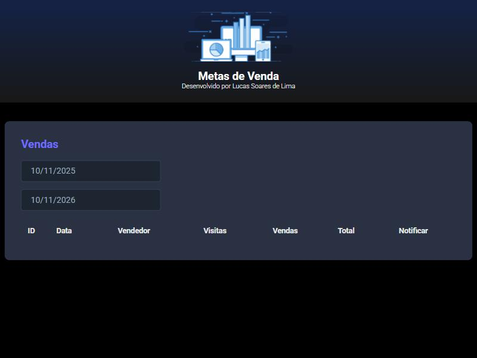

<h1 align="center">Sales META — Sales Dashboard</h1>

<p align="center">
  Full-stack sales dashboard built with <b>Java + Spring Boot</b> (REST API) and
  <b>React + TypeScript + Vite</b> (SPA). Browse sales, filter by date range and
  trigger an SMS notification per sale (Twilio). A personal project to practice
  full-stack development.
</p>

<p align="center">
  <a href="https://metasaleslucas.netlify.app"><b>🔗 Live demo</b></a> &middot;
  
  
  
  
</p>

> ℹ️ The live demo frontend is on Netlify and loads instantly. The API was hosted on a
> free tier that may be asleep, so the sales table can appear empty — run the backend
> locally (below) to see it fully populated.

---

## 📸 Preview



---

## ✨ Features
- List all sales in a table (ID, date, seller, visits, deals, amount).
- Filter sales by a start/end date range.
- Send an SMS notification for a given sale via Twilio.
- Seeded in-memory **H2** database — no external DB needed to run locally.

---

## 🛠️ Tech stack
**Backend:** Java 17, Spring Boot (Web, Data JPA, Security), H2, Twilio SDK, Maven.
**Frontend:** React 18, TypeScript, Vite, Axios, react-datepicker, react-toastify.

<p align="center">
   <a href="https://www.oracle.com/br/java/"></a>
   <a href="https://spring.io/"></a>
   <a href="https://www.typescriptlang.org/"></a>
   <a href="https://react.dev/"></a>
   <a href="https://developer.mozilla.org/en-US/docs/Web/JavaScript"></a>
   <a href="https://www.postman.com/"></a>
   <a href="https://www.netlify.com/"></a>
   <a href="https://git-scm.com/"></a>
</p>

---

## 🚀 How to run locally

### Prerequisites
- Java 17+ and Maven
- Node.js 18+

### 1. Backend (Spring Boot — port 8080)
```bash
cd backend
# SMS is optional; set these only if you want the Twilio notification to work:
#   export TWILIO_SID=...  TWILIO_KEY=...  TWILIO_PHONE_FROM=...  TWILIO_PHONE_TO=...
./mvnw spring-boot:run        # Windows: .\mvnw.cmd spring-boot:run
```
The API starts on `http://localhost:8080` with an in-memory H2 database
(console at `http://localhost:8080/h2-console`).

### 2. Frontend (React + Vite — port 5173)
```bash
cd frontend
npm install
# optional: point to a different API (defaults to http://localhost:8080)
#   echo "VITE_BACKEND_URL=http://localhost:8080" > .env
npm run dev
```
Open `http://localhost:5173`.

---

## 📁 Project structure
```
SalesMETA/
├── backend/            # Spring Boot REST API (Java)
│   └── src/main/java    # entities, repositories, resources (controllers), services
├── frontend/           # React + TypeScript (Vite)
│   └── src/components    # Header, SalesCard, NotificationButton
└── images/             # README assets + screenshots
```

---

<h3 align="center">
  Lucas Soares de Lima
  <br/>
  <a href="https://www.linkedin.com/in/lucasoalima/">LinkedIn</a> &middot;
  <a href="https://github.com/lucasoalima">GitHub</a>
</h3>
